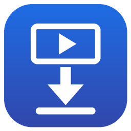

# Video Downloader

> **Educational project.** I made this to practice Python, Tkinter and working with libraries like yt-dlp.
> Please only download videos you own or have permission to download.

A simple Windows desktop app to download videos in the highest available quality.
Paste a link, press **Download**, and the video is saved to `Videos\Video Downloader`.

Built with Python and [yt-dlp](https://github.com/yt-dlp/yt-dlp), so it works with
[1,000+ sites](https://github.com/yt-dlp/yt-dlp/blob/master/supportedsites.md),
including YouTube, Google Drive, X, TikTok, Instagram and Facebook.

## Features

- Highest available quality: best video and best audio, merged into one MP4 file
- Shows the quality before downloading (for example `2160p 60fps`)
- Progress bar with speed and time left
- Auto retry and resume when the connection drops
- Clear error messages (unsupported site, private video, needs update)
- Terms of Use window on every start: the app only works after the user agrees
- One-click **Setup** button: opens a terminal window that installs or updates yt-dlp, ffmpeg and deno
- Arabic and English interface (your choice is remembered)
- Its own icon on the desktop, title bar and taskbar

## Requirements

- Windows 10 or 11
- Python 3.10 or newer, from [python.org](https://www.python.org/downloads/)
- `winget` (included in Windows 10/11), used by the Setup button

## Install

1. Download this repository (green **Code** button, then **Download ZIP**) and extract it.
2. Double-click `install.bat`. It creates a **Video Downloader** shortcut on your desktop, then installs yt-dlp, ffmpeg and deno.
3. Open the app from the desktop shortcut.

You can update the tools any time with the **Setup** button. It opens a terminal window and runs `setup.bat`.

If you move the folder later, run `install.bat` again to fix the shortcut.

## Usage

1. Copy a video link.
2. Press **Paste**, then **Download**.
3. Press **Open folder** to see your videos.

Use the **English / العربية** button at the top to switch the language.

If a site stops working, press the Setup button again to update yt-dlp.

## Disclaimer

This project is for **educational purposes only**. Every time the app starts, the user must accept the [Terms of Use](TERMS.md) before using it.

- Only download videos you own or have permission to download.
- Respect copyright law and each website's terms of service.
- Do not use this tool for any illegal or unethical purpose, such as piracy,
  re-uploading other people's content, or downloading private content without consent.
- The author is **not responsible** for any misuse of this tool or for any damage
  caused by it. You use it at your own risk and you are fully responsible for how you use it.

## Credits

- [yt-dlp](https://github.com/yt-dlp/yt-dlp): the download engine
- [FFmpeg](https://ffmpeg.org/): merging video and audio
- [Deno](https://deno.com/): needed by yt-dlp for YouTube

---

## بالعربي

برنامج بسيط لويندوز يحمّل الفيديوهات بأعلى جودة متوفرة. تلصق الرابط وتضغط **تحميل**، وينحفظ الفيديو في مجلد `Videos\Video Downloader`.

**طريقة التثبيت:**

1. حمّل المستودع واستخرجه.
2. اضغط ضغطتين على `install.bat`، ويسوي لك اختصار على سطح المكتب ويثبّت الأدوات.
3. افتح البرنامج من سطح المكتب.

وزر **تجهيز البرنامج** يفتح نافذة Terminal ويحدّث الأدوات في أي وقت.

**إخلاء مسؤولية:**

كل ما يشتغل البرنامج تطلع نافذة [شروط الاستخدام](TERMS.md)، وما يشتغل إلا إذا وافق المستخدم عليها.

- هذا المشروع لغرض تعليمي فقط.
- حمّل بس الفيديوهات اللي لك أو عندك إذن بتحميلها، واحترم حقوق النشر وشروط المواقع.
- يُمنع استخدام الأداة لأي غرض غير قانوني أو غير أخلاقي، مثل القرصنة، أو إعادة نشر محتوى غيرك، أو تحميل محتوى خاص بدون إذن صاحبه.
- صاحب المشروع **غير مسؤول** عن أي سوء استخدام للأداة أو أي ضرر ينتج عنها، والمستخدم يتحمل المسؤولية كاملة.

